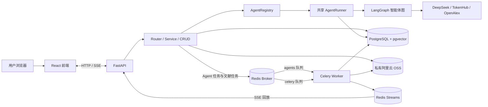

# NexusAI

NexusAI 是一个多智能体对话应用。用户在同一聊天界面中选择不同智能体，处理日常问答、商品图片与 Listing 生成、科研文献检索、劳动法规问答和文献解读。

项目采用 React + TypeScript 前端、FastAPI + LangGraph 后端。智能体共用会话、运行、流式事件和持久化能力，各自维护领域流程。


## 核心能力

| 智能体 | 能力 |
|---|---|
| `common_agent` | 日常交流、常见问题和项目智能体介绍 |
| `basic_conversation_agent` | 基于通用智能体基座进行多轮对话和结构化提问 |
| `image_agent` | 生成淘宝商品主图和详情页图片 |
| `listing_agent` | 识别商品信息、补充必要信息并生成 3 版商品 Listing |
| `research_agent` | 搜索 OpenAlex 学术论文并保存结构化结果 |
| `labor_law_agent` | 检索中国大陆全国性劳动法规并提供条文依据 |
| `literature_reader_agent` | 导入 PDF，基于所选文献进行问答、总结和比较 |

新注册账号获赠 100 积分；每轮新对话消耗 1 分，失败或主动取消后退回。账号栏显示余额。

## 技术栈

| 层次 | 技术 |
|---|---|
| 前端 | React 19、TypeScript 6、Vite 8 |
| 后端 | Python 3.12.13、FastAPI、Pydantic 2、SQLAlchemy 2 |
| 智能体编排 | LangGraph 1、共享 AgentRunner、SSE |
| 数据存储 | PostgreSQL 17、pgvector；SQLAlchemy ORM 与 LangGraph PostgreSQL Checkpointer |
| 异步任务 | Celery、Redis 7，用于文献导入和解析 |
| 文件存储 | 阿里云私有 OSS |
| 外部能力 | DeepSeek 对话模型、Tencent TokenHub 生图与 Embedding、OpenAlex 论文检索 |

## 技术架构



前端通过 HTTP 和 SSE 访问 FastAPI。后端由 Router、Service、CRUD 处理应用请求，注册中心按 `AgentType` 字符串枚举路由到对应智能体；会话保存使用的 `agent`，各智能体复用 Runner、Checkpoint、会话和事件协议。Compose 中的单个 Celery Worker 同时处理聊天和文献任务；聊天事件写入 Redis Streams 后供 SSE 连接回放，文献导入会解析 PDF 并生成向量，结果写入 PostgreSQL/pgvector，原始文件保存在 OSS。

## 本地启动

需要 Python 3.12.13、Node.js/npm 和 Docker。以下命令适用于 PowerShell。

1. 创建配置文件，并填写 `backend/.env` 中的数据库账号和 `DEEPSEEK_API_KEY`：

   ```powershell
   if (-not (Test-Path backend/.env)) { Copy-Item backend/.env.example backend/.env }
   ```

2. 启动 PostgreSQL 和 Redis：

   ```powershell
   docker compose --env-file backend/.env -f backend/compose.yaml up -d --remove-orphans postgres redis
   ```

   部署启用积分计费前，先对目标 PostgreSQL 执行 `backend/migrations/018_user_credits.sql`。该迁移为现有账号创建 0 分余额，不补发注册积分；应在启动新版 API 和 Worker 前完成。迁移完成后启动 Worker：

   ```powershell
   docker compose --env-file backend/.env -f backend/compose.yaml up -d --remove-orphans worker
   ```

3. 启动后端：

   ```powershell
   cd backend
   python -m pip install -r requirements.txt
   $env:LANGGRAPH_STRICT_MSGPACK = "true"
   python -m uvicorn main:app --host 127.0.0.1 --port 8000 --reload
   ```

4. 在另一个终端启动前端：

   ```powershell
   cd frontend
   npm install
   npm run dev
   ```

前端开发服务器默认通过 `/api` 代理到本地后端。后端 API 交互文档路径为 `/docs`；本地启动时访问 `http://127.0.0.1:8000/docs`。

启用邮箱账号功能前，在 `backend/.env` 设置 `MAIL_SMTP_USERNAME` 为完整 QQ 邮箱地址，在 QQ 邮箱设置中启用 SMTP 服务并生成授权码后填入 `MAIL_SMTP_PASSWORD`，再为 `AUTH_CODE_PEPPER` 配置随机长密钥。SMTP 密码必须使用邮箱生成的授权码，不能使用网页登录密码；不要将 `.env` 或真实授权码提交到 Git。验证码和会话使用现有 Redis，无需增加 PostgreSQL 认证表。若数据库含本次迭代早期创建的认证临时表，可执行 `backend/migrations/017_redis_auth_state.sql` 清理。登录 Cookie 在非开发环境默认使用 Secure，生产环境应通过 HTTPS 提供前端和 API。

使用生图、Embedding 或 PDF 存储能力时，按需配置 TokenHub 和私有 OSS 凭据。实习僧开放平台接入获批后，可在 `backend/.env` 中填写 `SHIXISENG_APP_ID` 和 `SHIXISENG_APP_SECRET`；当前改动仅预留服务端配置，岗位搜索调用尚未接入。Compose 中的 `worker` 同时处理 Agent 对话和文献导入；导入文献前还需应用文献数据库迁移。该 Worker 使用单进程串行处理任务，文献解析期间排队的对话任务会等待。变量、迁移和部署细节见 [`backend/.env.example`](backend/.env.example) 与[数据库结构说明](docs/数据库文档.md)。

### 使用 Docker 启动后端和 Worker

完成 `backend/.env` 配置后，在仓库根目录运行。首次启动或需要重建所有 Compose 服务时，使用：

```bash
docker compose --env-file backend/.env -f backend/compose.yaml up -d --build --remove-orphans
```

只需重建并启动后端和 Worker 时，使用：

```bash
docker compose --env-file backend/.env -f backend/compose.yaml up -d --build --remove-orphans backend worker
```

## 文档

- [项目知识地图](docs/项目知识地图.md)：项目模块、智能体、依赖和按任务检索入口。
- [后端架构](docs/架构说明.md)：模块职责、依赖方向和扩展方式。
- [API 接口](docs/接口文档.md)：路由、请求响应、SSE 和错误说明。
- [数据库结构](docs/数据库文档.md)：表、迁移和持久化说明。
- [开发约定](AGENTS.md)：代码变更与验证规则。
- [变更日志](CHANGELOG.md)：面向使用者的项目变化。
