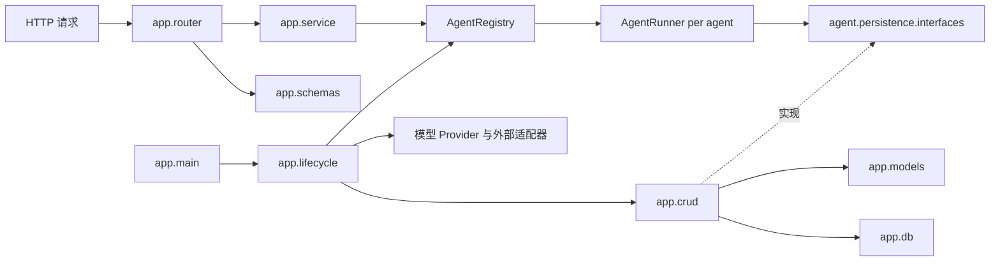

# 后端架构与扩展约定

本文说明后端模块的职责、依赖方向，以及新增能力应放置的位置。项目启动方式见根目录 [README](../README.md)，接口定义见[API 接口文档](API接口文档.md)，数据库定义见[数据库结构说明](数据库表结构.md)。

## 请求与组装流程

`app.lifecycle` 启动时创建各智能体图和 Runner，并将 `app.crud` 中的 PostgreSQL Store 注入运行器所依赖的持久化协议。每个 Runner 绑定独立图实例，但共享 Checkpointer、数据库连接池和 SSE 发布器。Router 按 `agent_id` 从显式注册表取得对应应用 Service。

## 模块职责

| 位置 | 职责 | 不负责 |
|---|---|---|
| `app/router/` | 接收 HTTP 参数、解析身份、调用 Service、转换 JSON/SSE 响应 | Agent 流程和 SQL |
| `app/service/` | 编排应用用例；不依赖 FastAPI 请求对象 | 直接执行 SQL |
| `app/crud/` | 按会话、消息、运行和任务结果执行 SQLAlchemy ORM 查询及持久化 | HTTP 参数解析和智能体图流程 |
| `app/models/` | 定义与 Pydantic DTO 分离的 SQLAlchemy 持久化模型 | HTTP 请求和响应校验 |
| `app/db/` | 创建 SQLAlchemy 引擎和 Session 工厂，管理数据库资源生命周期 | 业务查询和 HTTP 流程 |
| `app/schemas/` | 定义 HTTP 请求和响应 DTO | 保存图状态或数据库实体 |
| `agent/` | 提供共享 Runner、稳定事件、追问协议、持久化协议；保留现有默认智能体图 | 导入 `app`、FastAPI 或 HTTP DTO |
| `agents/` | 按业务目录保存独立智能体图、状态、节点、提示词、工具和 Provider 适配 | 复制公共 Runner、SSE 或持久化代码 |
| `agents/registry.py` | 按稳定 `agent_id` 显式登记智能体定义和应用 Service | 自动发现任意 Python 包 |
| `agent/persistence/interfaces.py` | 声明 Runner 所依赖的存储协议；`memory.py` 提供内存测试适配器 | PostgreSQL SQL 和 FastAPI 路由 |
| `infra/` | 集中管理配置及外部 Provider | 承载 HTTP 路由或业务图流程 |

## 依赖与数据边界

- Router 调用 Service；Service 按 `agent_id` 查找应用 Service 并调用 Runner。
- `agent/`、`agents/` 和基础设施模块不导入 FastAPI Router 或 HTTP DTO。
- `app.crud` 使用 SQLAlchemy ORM 实现 `agent.persistence.interfaces` 中的存储协议；Runner 只依赖协议，不直接依赖数据库模型或 PostgreSQL 实现。
- `app/models/` 保存数据库持久化模型；`app/schemas/` 保存 HTTP 请求与响应模型；`agent/schemas/` 保存运行记录、图问题、事件和任务结果领域记录。
- `app/db/` 创建 SQLAlchemy 引擎和会话工厂；CRUD 操作按调用创建并关闭短生命周期 Session。会话级 advisory lock 使用独立的 psycopg 连接池，使运行期间锁连接与 ORM 查询连接分离。`psycopg` 提供 PostgreSQL 驱动，LangGraph Checkpointer 继续使用其独立适配器。
- 应用启动时由 ORM 元数据创建缺失的应用表；`create_all` 不会修改已有表，结构变更仍须通过 `backend/migrations/` 管理。图片字节由 `infra/aliyun_oss.py` 保存到私有 OSS。
- `agent/errors.py` 定义运行时业务异常；`app/exceptions/handlers.py` 将其转换为 HTTP 响应。
- `infra/settings.py` 是配置入口。Provider 和智能体节点通过构造注入使用配置；节点和工具不直接读取环境变量。
- `app/dependencies/` 保存 HTTP 依赖，例如可信主体解析；`app/lifecycle.py` 负责运行资源的创建与释放。

数据库持久化范围见[数据库结构说明](数据库表结构.md)。

## 扩展默认智能体

`backend/agent/` 中的 `state.py`、`nodes/`、`tools/`、`prompts/` 和 `graph.py` 属于当前默认智能体。若要修改默认对话能力，可以继续在这些文件中扩展。`agent/tools/registry.py` 中的 `AGENT_TOOLS` 只登记默认图的工具。

## 新增独立智能体

1. 在 `backend/agents/<business_name>/` 新建业务状态、图、节点、系统提示词和专属工具。
2. 在 `backend/agents/registry.py` 与 `AgentDefinition` 中登记稳定 `agent_id`、名称、描述和能力。
3. 在 `app/lifecycle.py` 组装 Provider、图、Runner 和应用 Service；共享数据库、Checkpointer、问题协议和 SSE。
4. 将业务结果元数据保存到统一 `task_results` 表；大文件放入对象存储并在 JSON 元数据中保留对象键。
5. 为新图、追问恢复、Provider 错误、结果持久化和资源授权增加离线测试。

当前淘宝图片智能体位于 `backend/agents/image_generation/`，标识为 `taobao_image`。图片业务实现不放入默认智能体的业务图目录。

## 增加普通业务数据

在 `app/modules/<业务名>/` 下按需增加 `router/`、`service/`、`crud/`、`models/` 和 `schemas/`。CRUD 负责该业务的数据读写；只有确有独立的数据需求时才新增对应模块，不为每张表机械地增加一层抽象。

MCP 接入属于工具能力时放在智能体 Tools 或独立集成模块；RAG 的文档处理、切分、Embedding、检索和生成应作为独立 AI 模块，不放进通用 Router、CRUD 或 Agent Service。
