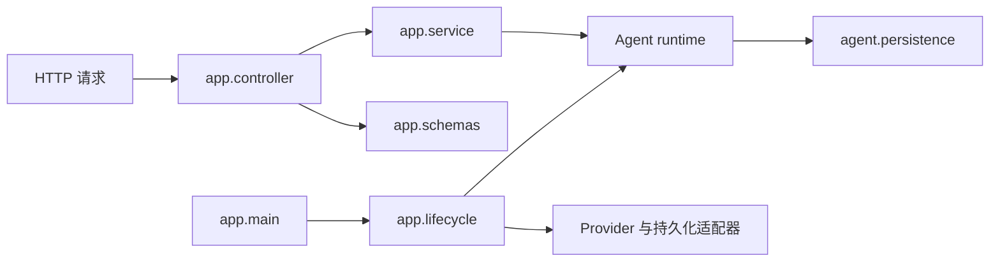

# 后端架构与扩展约定

本文说明后端模块的职责、依赖方向，以及新增能力应放置的位置。项目启动方式见根目录 [README](../README.md)，数据库定义见[数据库结构说明](数据库表结构.md)。

## 请求与组装流程

箭头表示调用或依赖方向。`app.lifecycle` 在应用启动时组装模型 Provider、Agent runtime 和持久化适配器；请求进入 Controller 后，由 Service 调用相应能力。

## 模块职责

| 位置 | 职责 | 不负责 |
|---|---|---|
| `app/controller/` | 接收 HTTP 参数、解析依赖、调用 Service、转换 JSON/SSE 响应 | Agent 流程和 SQL |
| `app/service/` | 编排应用用例；不依赖 FastAPI 请求对象 | 直接执行 SQL |
| `app/schemas/` | 定义 HTTP 请求和响应 DTO | 保存 Agent 内部状态或数据库实体 |
| `agent/` | 管理图状态、节点、工具、运行和稳定事件 | 导入 `app` 或 FastAPI |
| `agent/persistence/` | 持久化 Checkpoint 周边的会话、消息和运行状态 | 通用业务 Repository |
| `infra/` | 集中管理设置及外部 Provider | 承载 HTTP 路由或 Agent 业务流程 |

当前不单独创建 `app/repositories/`：会话、消息和运行记录属于 Agent runtime 的基础设施。只有出现独立于 Agent runtime 的业务数据时，才为该业务增加 Repository。

## 依赖与数据边界

- Controller 可以调用 Service；Service 可以调用 Agent runtime 或持久化协议。依赖只朝被调用方流动。
- Agent 和基础设施模块不导入 `app`、FastAPI 或 HTTP DTO。
- `app/schemas/` 保存 HTTP 请求与响应模型；`agent/schemas/` 保存图状态、运行记录、事件和工具载荷。两类模型不混用。
- 当前没有 SQLAlchemy ORM。Agent 持久化适配器管理自己的 SQL 表；未来的业务 ORM Model 应放在对应业务模块，并与 API Schema 分开。
- `agent/errors.py` 定义 Agent 领域异常；`app/exceptions/handlers.py` 将其转换为 HTTP 响应。
- `infra/settings.py` 是配置入口。Controller、Service、Provider 和 Agent 通过依赖或构造注入使用配置；节点和工具不直接读取环境变量。
- `app/dependencies/` 保存 HTTP 依赖，例如可信主体解析；`app/lifecycle.py` 负责运行资源的创建与释放。

数据库持久化范围见[数据库结构说明](数据库表结构.md)。

## 新增能力放置规则

### 扩展 Agent

1. 在 `agent/state.py` 中增加有界、可序列化的状态字段。
2. 在 `agent/nodes/` 中实现职责单一的节点；节点不依赖 HTTP 请求对象。
3. 在 `agent/tools/` 中实现有类型约束的工具，并在 `registry.py` 的 `AGENT_TOOLS` 清单中登记。
4. 在 `agent/prompts/` 中维护提示词；外部文档、工具结果和用户文本都视为不可信输入。
5. 在 `agent/graph.py` 中连接节点、工具和停止条件，并为新增流程补充测试。

`AGENT_TOOLS` 是唯一智能体的工具清单，不是智能体注册中心。项目不需要复制 Agent 目录、定义 `agent_id` 或实现 Agent 发现与路由。

### 增加普通业务数据

在 `app/modules/<业务名>/` 下按需增加 `controller/`、`service/`、`repository/`、`models/` 和 `schemas/`。只在确有独立业务持久化需求时添加 Model 和 Repository。

MCP 接入属于工具能力时放在 Agent Tools 或独立集成模块；RAG 的文档处理、切分、Embedding、检索和生成应作为独立 AI 模块，不放进通用 Controller、Repository 或 Agent Service。
