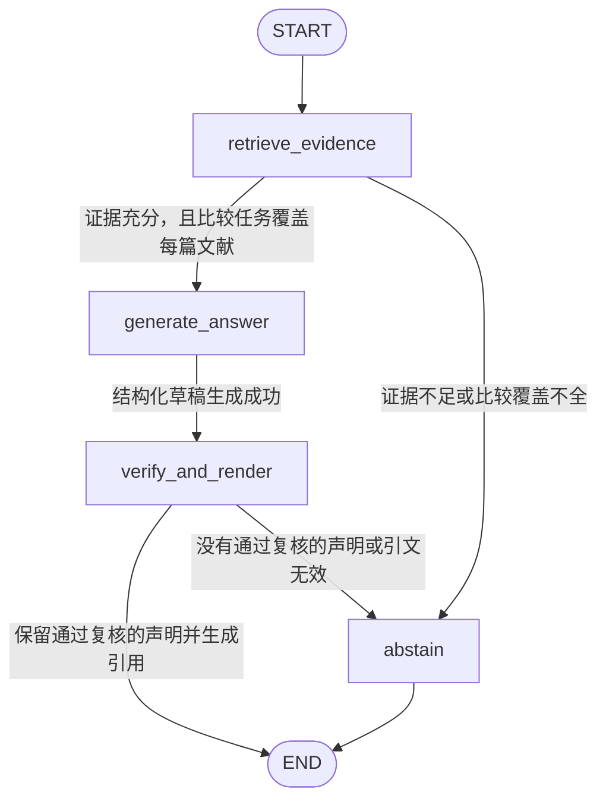
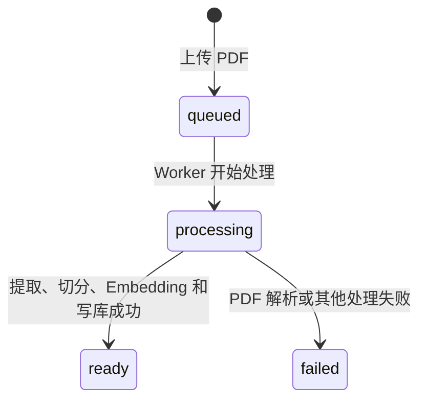

# 文献解读助手实现方案

- 日期：2026-10-16
- 状态：首版代码已实现；部署环境仍需配置基础服务并应用数据库迁移
- 技术方案：方案 B（标准生产方案）
- 目标智能体标识：literature_reader_agent

## 1. 需求简述

面向文献阅读人员提供一个中文文献助手。用户可以上传 PDF，保存多篇文献，并选择一篇或多篇文献提问。助手支持问答、解读、总结、梳理研究方法和比较结论。

回答只能依据所选文献内容。PDF 回答应标注章节、页码和段落；文献没有提供足够依据时，明确说明。文献和对话历史均需保存；第一版按项目现有的单一可信主体模式运行，不增加账号系统。

## 2. 项目现状与复用点

- 后端使用 FastAPI、LangGraph、SQLAlchemy、PostgreSQL 和共享 Agent Runner；前端使用 React、TypeScript 和 Vite。
- PostgreSQL 已启用 pgvector。劳动法律智能体已有 Embedding、关键词/向量检索和证据引用校验的实现范例。
- 私有阿里云 OSS 已用于图片文件；文献文件应使用独立的 PDF 对象存储适配器，避免把图片专用校验逻辑用于 PDF。
- Compose 已包含 Redis 服务，但当前应用尚未用 Redis。方案 B 使用该 Redis 作为 Celery Broker，增加文献 Worker。
- 科研文献检索智能体通过 OpenAlex 查找论文元数据，不负责用户上传文献的全文解析和基于原文的问答；本需求应新增独立智能体。
- 会话、消息、Checkpoint、智能体注册和 SSE 已有通用实现，可继续复用。
- 当前开发模式默认主体为 local-development；非 development 环境要求认证中间件提供可信主体。本方案复用此主体隔离方式，不新增登录流程。

## 3. 架构设计

### 3.1 技术组成

| 模块 | 选型 |
|---|---|
| Web 前端 | 复用 React、TypeScript、Vite |
| API 与业务流程 | 复用 FastAPI、LangGraph 和现有智能体运行时 |
| 文献与会话数据 | PostgreSQL、SQLAlchemy、现有雪花 ID |
| 文本向量检索 | PostgreSQL + pgvector，复用现有数据库 |
| 原始文献存储 | 阿里云私有 OSS |
| 异步任务 | Celery Worker + Redis Broker；任务状态以 PostgreSQL 文献记录为准，不依赖 Celery Result Backend |
| 模型服务 | 复用现有 DeepSeek 对话模型和 TokenHub Embedding 接入；向量维度与选定 Embedding 模型保持一致，首版按现有 1024 维配置设计 |
| 任务调度 | 首版不增加定时调度；文献由用户主动上传 PDF |
| 架构模式 | 模块化单体 API + 独立文献处理 Worker |

### 3.2 核心流程

1. 用户上传 PDF。
2. API 校验主体、PDF 格式和大小，将原始文件保存到私有 OSS，在 PostgreSQL 建立文献记录，并将解析任务发送到 Redis/Celery。
3. Worker 从 OSS 读取 PDF，提取正文、章节与位置信息，按段落切分并生成 Embedding，将分块和向量写入 PostgreSQL。
4. 前端展示文献处理状态；成功后用户在对话中选择一篇或多篇文献。
5. 助手在所选文献范围内执行检索；普通问答和方法梳理使用关键词与向量混合检索，总结任务按原文顺序均匀取样全文分块，再受上下文长度上限约束。
6. LangGraph 回答节点只接收检索到的文献证据，按结构化格式返回回答和证据 ID。
7. 服务端校验证据 ID 及其文献位置，再生成中文出处标注；不满足证据要求时返回固定的依据不足说明。
8. 对话消息沿用现有会话和消息表保存；文献与会话的关联单独持久化，以便重新打开历史会话时恢复文献选择。

### 3.3 文本提取与引用规则

- PDF 按页提取文本；段落序号由解析器按每页抽取顺序生成，章节/节标题根据文档中的标题文本识别。模型不能自行编造章节、页码或段落。
- 检索分块保留页码范围、段落范围和章节信息。回答引用由服务端根据证据 ID 生成，不接受模型自行提供的页码。
- 英文文献使用中文回答；总结、研究方法梳理和跨文献比较可以归纳原文明确表达的内容，但每项事实都需要对应证据，不补充文献未支持的结论。
- 新建文献仅支持上传 PDF；不提供 URL 导入或网页解析。
- 首版只处理可提取文本的 PDF；扫描件或无可提取正文的文件提示导入失败，不包含 OCR。

### 3.4 智能体状态机（LangGraph）

图中只保留会改变运行控制路径的节点。输入格式、主体归属、文献 ready 状态等前置校验在 API/Service 层完成，通过后才启动 LangGraph；意图分类、检索词规划、混合检索和证据充分性判断合并在 retrieve_evidence 节点内部。

#### 节点职责

| 节点 | 职责 |
|---|---|
| retrieve_evidence | 在 API 已验证的文献范围内识别问答、总结、方法梳理或结论比较任务；普通问答和方法梳理执行关键词与 pgvector 混合检索，总结按原文顺序抽取跨全文代表性分块；比较与总结逐篇检查证据覆盖情况。 |
| generate_answer | 仅接收检索证据，生成中文结构化回答；每条事实声明列出支持它的证据 ID。 |
| verify_and_render | 校验输出结构和证据 ID，确认模型提交的原文摘录逐字出现在对应证据分块中，再对照原文检查事实支持关系；过滤未通过的声明，部分过滤时追加固定的依据不足说明；只由服务端按证据 ID 生成位置标注。 |
| abstain | 输出明确的依据不足说明，不调用模型补写文献未提供的内容。 |

#### 条件边

| 起点 | 条件 | 终点 |
|---|---|---|
| START | API/Service 已通过输入、主体归属、文献范围和 ready 状态检查 | retrieve_evidence |
| retrieve_evidence | 检索成功，单篇证据充分；或比较任务中的每篇文献均有足够证据 | generate_answer |
| retrieve_evidence | 没有足够证据，或比较任务中至少一篇文献缺少可用证据 | abstain → END |
| generate_answer | 模型生成可解析的结构化草稿 | verify_and_render |
| verify_and_render | 至少一条声明通过复核，且模型提交的引文逐字匹配 | END；被过滤的声明附固定依据不足提示 |
| verify_and_render | 没有声明通过复核，或任一引文无效 | abstain → END |

图外处理：输入无效、文献不属于当前主体或文献未就绪时，API/Service 返回业务错误，不启动图。模型调用、数据库检索或引用校验发生系统异常时，由现有 AgentRunner 转为 RUN_FAILED 事件；这些故障不是文献证据不足，也不额外设置 LangGraph 错误节点。结构化输出格式异常按受控运行失败处理。

图状态只保存消息、任务类型、所选文献 ID、证据 ID 和输出状态；完整分块正文不写入 Checkpoint。生成和校验节点按证据 ID 从 PostgreSQL 读取原文位置与内容。

首版不向模型开放自主选择的函数工具。PDF 导入、文献库管理、可信主体校验和会话文献绑定由应用服务处理；图中的检索节点固定调用内部检索服务，Worker 固定从 OSS 读取 PDF 并执行解析和向量化。模型只生成回答草稿并复核声明，不自行决定调用外部系统。
### 3.5 文献入库状态机

Worker 将当前阶段和安全错误说明写入 literature_documents。只有 ready 文献可以进入问答检索范围。没有可读取 PDF 原件的历史链接记录不能重新入库，需重新上传 PDF。删除是物理删除，不作为保留在文献表中的状态；操作同时清理 PostgreSQL 分块和会话关联，并删除 OSS 原件（若有）。

## 4. 数据库表设计

现有 conversations、messages、agent_runs、users 和 LangGraph Checkpoint 继续保存会话、消息、运行与用户映射。本功能新增以下三张业务表；不将 PDF 字节写入 PostgreSQL。

### 4.1 literature_documents

文献元数据、OSS 对象位置和异步处理状态。

| 字段 | 类型 | 说明 |
|---|---|---|
| document_id | BIGINT 主键 | 雪花 ID，API 中以十进制字符串传递 |
| owner_id | BIGINT 外键 | 关联 users.user_id |
| title | TEXT | 文献标题或用户可见名称 |
| source_type | TEXT | 新建文献固定为 pdf_upload；兼容既有 pdf_url、web_url 记录 |
| source_url | TEXT，可空 | 为读取既有链接导入记录保留；新接口不写入 |
| file_name | TEXT，可空 | 上传文件名 |
| object_key | TEXT，可空 | 私有 OSS 对象键；历史网页来源可为空 |
| content_type | TEXT | PDF 文件内容类型；历史网页来源可能保留原类型 |
| file_size | BIGINT，可空 | 文件字节数 |
| content_sha256 | VARCHAR(64)，可空 | 文件内容摘要，可用于重复检测 |
| status | TEXT | queued、processing、ready 或 failed |
| error_code | TEXT，可空 | 稳定的处理失败代码 |
| error_message | TEXT，可空 | 面向用户的安全错误说明 |
| page_count | INTEGER，可空 | 成功解析的 PDF 页数 |
| created_at / updated_at | TIMESTAMPTZ | 创建和最近更新时间 |

索引：按 owner_id 和 updated_at 倒序查询；可按 content_sha256 实施重复文件检测。

### 4.2 literature_chunks

按可引用位置切分的文献正文与向量。

| 字段 | 类型 | 说明 |
|---|---|---|
| chunk_id | BIGINT 主键 | 雪花 ID |
| document_id | BIGINT 外键 | 关联 literature_documents.document_id，删除文献时级联删除 |
| chunk_index | INTEGER | 文献内分块顺序 |
| content | TEXT | 文献原文片段 |
| chapter | TEXT，可空 | 识别出的章标题 |
| section | TEXT，可空 | 识别出的节标题 |
| page_start / page_end | INTEGER，可空 | PDF 页码范围；历史网页来源为空 |
| paragraph_start / paragraph_end | INTEGER，可空 | 页内段落序号范围；历史网页来源为空 |
| embedding | VECTOR(1024) | 与 Embedding 模型维度一致的向量 |
| created_at | TIMESTAMPTZ | 写入时间 |

约束与索引：UNIQUE(document_id, chunk_index)；为 embedding 建 HNSW cosine 索引；为 document_id 建普通索引。混合检索限定在当前主体拥有且状态为 ready 的所选文献中。

### 4.3 literature_conversation_documents

保存每段文献助手对话当前关联的文献集合，供历史会话恢复选择状态。

| 字段 | 类型 | 说明 |
|---|---|---|
| conversation_id | BIGINT 外键 | 关联 conversations.conversation_id |
| document_id | BIGINT 外键 | 关联 literature_documents.document_id |
| added_at | TIMESTAMPTZ | 建立关联的时间 |

主键为 (conversation_id, document_id)。仓储查询必须同时验证会话和文献属于当前可信主体。删除文献时删除关联；既有对话消息仍保留。

## 5. 后端接口设计

接口使用项目统一的 success/data JSON 包装；ID 均以字符串形式传输。写入类接口通过现有可信主体依赖校验所有权。

| 方法与路径 | 用途 | 主要输入/输出 |
|---|---|---|
| POST /api/v1/literature/documents | 上传 PDF 并排入解析队列 | multipart PDF；返回 document_id、status=queued |
| GET /api/v1/literature/documents | 查询文献库 | 支持分页；返回文献状态和失败说明 |
| GET /api/v1/literature/documents/{document_id} | 查询单篇文献及处理状态 | 返回标题、来源、状态、页数和错误说明 |
| DELETE /api/v1/literature/documents/{document_id} | 删除文献 | 删除文献分块、会话关联和对应 OSS 文件 |
| POST /api/v1/literature/chat/stream | 按选定文献进行流式问答 | JSON message、可选 conversation_id、document_ids；返回项目统一 SSE 事件 |
| GET /api/v1/literature/conversations/{conversation_id}/documents | 恢复历史会话关联的文献 | 返回 document_ids 和文献摘要 |
| PUT /api/v1/literature/conversations/{conversation_id}/documents | 更新历史会话关联的文献 | JSON document_ids；校验所有权和文献状态 |

问答请求中的 document_ids 在新会话首轮必填；后续请求可使用已保存的会话关联。文献未完成处理时返回明确的业务错误，不启动问答。无法读取 PDF 原件的历史链接记录不能重新处理，界面提示用户重新上传 PDF。

## 6. 需要新增或修改的代码

### 后端新增

| 路径 | 职责 |
|---|---|
| backend/agents/literature_reader_agent/ | 独立智能体目录，包含状态、图、提示词、PDF 解析、切分、检索和导入流程 |
| backend/agents/literature_reader_agent/document_parser.py | PDF 分页提取和章节/段落位置记录 |
| backend/agents/literature_reader_agent/chunker.py | 保留引用位置的段落切分及 Embedding 批处理 |
| backend/agents/literature_reader_agent/retrieval.py | 按所选文献执行关键词和 pgvector 混合检索 |
| backend/agents/literature_reader_agent/graph.py | 四节点图、证据 ID 校验、原文支持检查及服务端引用生成 |
| backend/app/service/literature_tasks.py | Celery PDF 读取、解析、向量化和状态更新任务 |
| backend/infra/literature_document_storage.py | PDF 私有 OSS 写入、读取和删除适配 |
| backend/infra/celery_app.py | Celery 应用与 Redis Broker 配置 |
| backend/app/models/literature.py | 三张新增表的 SQLAlchemy ORM 模型 |
| backend/app/crud/literature.py | 文献、分块及会话文献关系的 PostgreSQL 操作 |
| backend/agents/literature_reader_agent/schemas.py | 文献、分块、证据和图运行时数据结构 |
| backend/app/schemas/literature.py | 文献 HTTP 请求与响应 DTO |
| backend/app/service/literature.py | 文献入库、状态、所有权、会话选择和问答编排 |
| backend/app/router/literature.py | PDF 文献管理和 SSE 问答路由 |
| backend/migrations/005_literature_reader.sql | pgvector 表、约束和索引迁移 |

### 后端修改

| 路径 | 修改内容 |
|---|---|
| backend/agent/constants.py | 注册稳定 agent_id 和输入边界常量 |
| backend/agents/database_ids.py | 为新智能体分配下一个稳定静态雪花 ID |
| backend/agents/definition.py、backend/agents/registry.py | 注册文献解读助手及文档能力描述 |
| backend/bootstrap/runtime.py | 装配文献仓储、Embedding、检索服务、图和 Agent Runner |
| backend/bootstrap/application.py | 注册文献 API Router |
| backend/app/service/agent.py | 为流式运行透传受控 graph_context，使文献 ID 进入图状态 |
| backend/app/models/__init__.py | 导入新 ORM 模型 |
| backend/infra/settings.py、backend/.env.example | 增加 Redis/Celery、PDF 上传和切分配置 |
| backend/requirements.txt | 增加 Celery、python-multipart 等实际需要的依赖 |
| backend/compose.yaml | 增加文献 Worker 服务；让 API/Worker 依赖现有 Redis 与 PostgreSQL |

### 前端新增与修改

| 路径 | 修改内容 |
|---|---|
| frontend/src/features/chat/api/literature.ts | PDF 上传、列表、删除、会话关联和流式问答 API |
| frontend/src/features/chat/components/LiteratureLibraryPanel.tsx | 展示文献库、导入进度、失败原因和删除操作 |
| frontend/src/features/chat/constants.ts | 文献解读助手稳定前端标识 |
| frontend/src/features/chat/ChatPage.tsx | 为文献解读智能体显示文献库与文献选择交互 |
| frontend/src/features/chat/hooks/useChatSession.ts | 管理文献上传状态、所选文献、会话恢复和 SSE 问答 |
| frontend/src/features/chat/api/agent.ts | 补充智能体文档能力字段 |
| frontend/src/shared/api/http.ts | 支持 multipart/form-data 文献上传 |

## 7. 实施步骤

1. 增加文献 Agent 标识、Embedding/PDF 上传配置和 Celery 依赖；在 Compose 增加 Worker。
2. 创建 ORM 模型和 005 SQL 迁移，增加文献 CRUD、单用户所有权校验和 PDF OSS 适配器。
3. 增加 PDF 上传 API 与 Celery 任务；实现文件校验、OSS 读取、解析、分段、Embedding 和状态轮询。
4. 增加 pgvector 混合检索、文献范围过滤、回答结构化输出、证据 ID 校验和依据不足兜底。
5. 构建 literature_reader_agent 图，注册到 AgentRegistry，并增加带 document_ids 的 SSE 问答和会话文献关联恢复。
6. 实现前端文献库、PDF 上传、状态反馈、文献选择、对话恢复和引用展示。
7. 已同步 API、数据库和架构说明，并按项目约定补充任务级变更记录与 CHANGELOG。
8. 已运行文献模块自动化测试、后端完整测试套件和前端生产构建；实际命令及结果记录在 `docs/changes/2026-10-16-003-implement-literature-reader.md`。

### 实施状态与部署要求

- 后端 API、Celery Worker、文献四节点图、PostgreSQL/pgvector 仓储、私有 OSS 适配及前端文献库和历史选择已实现。总结任务按全文分块顺序均匀抽样，并受配置的上下文长度限制。
- Worker 与 API 共用 PostgreSQL、Redis 和 OSS 配置。新增 `LITERATURE_WORKER_SNOWFLAKE_ID` 默认值为 `1`，与 API `SNOWFLAKE_WORKER_ID` 分离。扩展到多个 Worker 进程时必须为每个进程配置唯一值。
- 部署前需配置 `ALIYUN_OSS_*`、`TENCENT_TOKENHUB_API_KEY` 和 `CELERY_BROKER_URL`，并按数据库升级流程执行 `backend/migrations/005_literature_reader.sql`。未配置 OSS 时，PDF 上传会明确返回服务不可用。
- 本地自动化测试不连接真实 PostgreSQL、Redis、TokenHub 或 OSS。数据库迁移、Compose Worker 和真实文献端到端流程仍需在部署环境完成验证。

## 8. 验收条件

- 可上传多份文本型中英文 PDF；原文件存于私有 OSS，文献元数据、正文分块和向量持久化在 PostgreSQL。
- 任务处理中或失败的文献不能被问答检索；完成后的文献可被选择、删除并在历史会话中恢复。
- 单篇问答、总结、方法梳理和多篇结论比较均限定在用户选择的文献集合。
- 回答用中文；PDF 引用章节、页码和页内段落位置由服务端证据生成。
- 证据不足时返回明确说明；模型引用不存在的证据 ID 时拒绝该回答或回退到依据不足说明。
- 对话消息和会话继续使用现有持久化流程；服务重启后文献库、处理状态和历史对话仍可读取。
- 未登录单用户模式沿用当前 development 主体；其他环境必须由可信认证中间件提供主体，不接受客户端传入 owner_id。

## 9. 首版边界与待配置项

- URL 导入、扫描件 OCR、定时网页刷新和跨用户文献共享不属于首版。
- PDF 页内段落编号由文本解析结果生成；章节标题使用启发式识别，未识别时会明确标注“章节未识别”；双栏、复杂表格或排版异常文档可能需要后续改进解析器。
- 事实支持复核由对话模型执行，服务端另行强制验证引用 ID 和原文摘录逐字匹配；这能过滤无出处和引用不实的输出，但仍不构成对语义正确性的形式化证明。
- 文件大小、最大页数、分块窗口和检索阈值均已做成配置项并设置默认值；部署时按模型和资源限额调整。
- 中英文混合语料需要用项目实际论文样本验证 Embedding 的跨语言检索效果；若现有 Kinfra 模型效果不足，再单独调整模型与向量维度迁移，不提前引入独立向量数据库。
