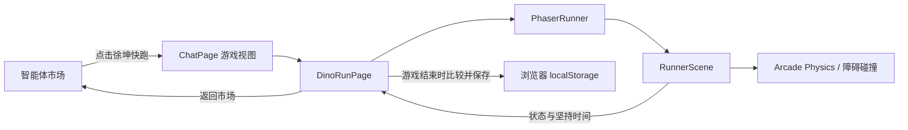

# 《徐坤快跑》产品与技术实现文档

本文将产品需求（PRD）、技术设计（TDD）和执行任务清单（TODO）合并维护，避免为同一小游戏拆成多份方案文档。

## 1. 产品需求（PRD）

### 产品概述

《徐坤快跑》是 NexusAI 智能体市场中的桌面网页小游戏。玩家控制蔡徐坤卡通形象自动向前奔跑，通过跳跃和下蹲避开障碍，目标是坚持更久并刷新当前浏览器中的个人最长时间。

### 用户与范围

- 用户：NexusAI 网页端用户。
- 平台：桌面网页，使用键盘操作；不提供手机触屏操作。
- 游戏模式：单人、无尽跑酷。
- 记录：只保存最长坚持时间，不显示分数、不提供跨设备或用户排行榜。

### 用户流程

1. 用户在智能体市场点击《徐坤快跑》卡片。
2. 游戏在主内容区打开，NexusAI 侧边栏保持显示，并提供返回市场按钮。
3. 用户点击“开始游戏”，或在游戏画面按空格键/上方向键开始。
4. 角色自动奔跑；空格键或上方向键跳跃，下方向键下蹲。
5. 用户可通过暂停按钮或 P / Esc 暂停、继续；切换到其他浏览器标签时自动暂停。
6. 撞到仙人掌或飞鸟后显示本局坚持时间，若超过历史记录则更新浏览器内最长时间。
7. 用户可以重新开始或返回市场。

### 功能拆解

- 市场入口：作为独立游戏卡片展示，头像从蔡徐坤角色精灵图裁出头肩像；不登记为后端智能体，智能体列表加载失败时游戏入口仍可用。
- 游戏状态：准备、进行、暂停、结束；结束后可重新开始。
- 操作：空格/上方向键跳跃，下方向键下蹲；P / Esc 暂停或继续，即使焦点在游戏按钮上也有效。
- 障碍：地面仙人掌和飞行障碍；奔跑速度随坚持时间逐渐增加。
- 场景：跑道下方显示带金属接缝和水面的排水管道横截面。
- 计时：显示本局坚持时间与个人最长记录；暂停期间不累计时间。
- 视觉：沿用 NexusAI 蓝白界面风格；蔡徐坤卡通角色使用黑色标志性发型、蓝白 9 号篮球服和红白球鞋的本地四帧跑步素材，下蹲时角色也会压低姿势。

## 2. 技术设计（TDD）

### 技术选型

- 前端外壳：项目现有 React、TypeScript、Vite。
- 游戏引擎：Phaser 4.2.1，使用 Arcade Physics 处理重力、落地和障碍碰撞。
- 渲染：使用 Phaser 默认渲染器；游戏画布按固定逻辑尺寸缩放适配主内容区。
- 数据持久化：浏览器 `localStorage`；不新增后端 API、数据库、缓存服务、队列或定时任务。
- 外部服务：运行时不调用 AI 或第三方服务，角色和障碍素材随前端静态资源发布。

### 模块划分

- `frontend/src/features/chat/ChatPage.tsx`：管理目录、游戏、对话三个主视图；游戏打开时保留侧边栏和已挂载的聊天工作区。
- `frontend/src/features/chat/components/AgentDirectory.tsx`：提供独立的小游戏入口；该卡片不参与智能体 API 注册和对话选择。
- `frontend/src/index.css`：从跑步精灵图放大裁出卡片头像，沿用智能体头像的圆角容器样式。
- `frontend/src/features/dino-run/DinoRunPage.tsx`：游戏页面、状态覆盖层、按钮、计时展示和浏览器标签切换时的自动暂停。
- `frontend/src/features/dino-run/components/PhaserRunner.tsx`：创建 Phaser 实例、转发状态与控制命令，并在离开页面时销毁实例。
- `frontend/src/features/dino-run/scenes/RunnerScene.ts`：游戏场景与下水管道绘制、键盘输入、角色跳跃/下蹲、障碍生成、加速与 Arcade Physics 碰撞。
- `frontend/src/features/dino-run/model/record.mjs`：读取、格式化和更新浏览器内最长时间。
- `frontend/src/features/dino-run/model/gameConfig.ts`：集中定义 Phaser 逻辑画布尺寸。
- `frontend/public/games/xukun-runner.png`：四帧蔡徐坤卡通跑步图。

### 主流程

### 状态与记录规则

- 状态转换：`ready → running → paused → running`；碰撞后进入 `gameover`；重新开始重置本局计时和障碍。
- 计时由 Phaser 游戏循环推进；暂停、游戏结束和浏览器标签隐藏期间冻结。
- 存储键：`nexusai.xukun-run.best-time.v1`。
- 存储值：最长坚持毫秒数的十进制字符串；只有本局超过已存记录时才写入。
- 浏览器禁用或拒绝 `localStorage` 时，游戏仍可运行，本局内保留显示值，但不保证跨页面刷新保存。

### 生命周期与性能

- Phaser 页面使用 React 懒加载，用户打开小游戏时才加载游戏代码。
- 离开游戏页时移除 Phaser 事件监听并销毁游戏实例，避免重复画布和循环。
- 固定游戏逻辑画布为 960×440，通过 Phaser `Scale.FIT` 适配页面可用区域。
- 游戏不调用聊天 Runner，也不创建游戏专属后端状态或业务表。

## 3. 执行清单（TODO）

- [x] 安装并锁定 Phaser 4.2.1。
- [x] 在智能体市场加入独立游戏卡片，并保留现有智能体卡片逻辑。
- [x] 在 ChatPage 增加目录、游戏、对话视图切换，保留侧边栏。
- [x] 实现 Phaser 场景、角色动画、键盘跳跃/下蹲、障碍、碰撞、暂停、结束和重开。
- [x] 实现本局计时和浏览器最长时间记录。
- [x] 生成并接入带有蔡徐坤标志性黑发、9 号篮球服等特征的卡通四帧跑步素材。
- [x] 合并 PRD、TDD、TODO 为本文档。
- [x] 运行前端构建和前端单元测试。

## 4. 验证结果

- `npm run build`（`frontend/`）：通过。Vite 提示 Phaser 页面 chunk 大于 500 kB；该 chunk 通过懒加载，只在进入游戏时加载。
- `npm test`（`frontend/`）：通过，8 项测试全部通过，包含最长时间读取、写入和时间格式化测试。
- `git diff --check`：实施完成后执行并记录于任务级变更记录。
