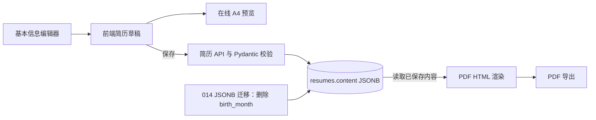

# 简历顶部信息展示方案

- 日期：2026-10-20
- 状态：已实施（2026-10-20）
- 变更范围：简历助手基本信息编辑、A4 预览、PDF 导出与简历 JSON 数据契约

## 目标

调整简历页首信息为两行摘要，并保持在线预览和导出 PDF 一致：

- 第二行按“求职意向、工作经验年限”排列。
- 第三行按“手机号、邮箱、年龄、学历”排列。
- 删除出生年月输入；年龄和工作经验年限均由用户手动填写，不从日期或工作经历计算。
- 学历从教育经历中取第一条已填写的学历。

## 已确认需求

1. 年龄以“岁”为单位手动输入，不再保存或计算出生年月。
2. 工作经验年限由用户手动输入，不汇总工作经历的起止月份。
3. 学历按教育经历顺序，取第一条学历字段非空的记录。
4. 第二行顺序固定为求职意向在前、工作经验在后；第三行顺序固定为手机号、邮箱、年龄、学历。
5. 简历预览展示当前编辑草稿；PDF 导出仍使用已保存简历。

## 当前实现

- `frontend/src/features/resume/components/BasicInfoEditor.tsx` 编辑姓名、电话、邮箱、求职意向和 `birth_month`。
- `frontend/src/features/resume/model/types.ts` 的 `BasicInfo` 与默认草稿包含 `birth_month`。
- `frontend/src/features/resume/components/ResumePreview.tsx` 第二行只显示求职意向；第三行拼接电话、邮箱和出生年月。
- `frontend/src/features/resume/styles/resume.css` 控制在线预览页首的行距和字号。
- `backend/app/schemas/resume.py` 使用严格字段模型校验简历 JSON；当前基本信息字段包含 `birth_month`。
- `backend/app/service/resume.py` 将简历内容写入和读取 `resumes.content` JSONB。
- `backend/app/service/resume_pdf.py` 独立生成导出 PDF 使用的 HTML，目前第二、三行与在线预览使用相同的数据来源。
- `backend/migrations/013_resumes.sql` 创建简历 JSONB 存储；数据库没有单独的出生年月列。

## 方案与数据规则

### 数据字段

- 在 `basic_info` 中用 `age: int | null` 取代 `birth_month`，界面标签为“年龄（岁）”。
- 增加 `work_experience_years: int | null`，界面标签为“工作经验（年）”。
- 两字段均可留空；计划按整数年输入，不做日期换算或工作经历汇总。年龄建议校验为 0–120，工作经验年限建议校验为 0–80。
- 学历不新增冗余字段，继续使用 `educations[].degree`。展示时按数组顺序找到第一条 `degree` 去除首尾空格后非空的教育经历。
- 不改变姓名、电话、邮箱、求职意向和教育经历的既有保存方式。

### 页首展示

- 第二行把有值的求职意向和工作经验拼在一起，顺序固定；工作经验格式为“X年工作经验”。
- 第三行按手机号、邮箱、年龄、学历顺序显示。年龄格式为“X岁”，学历显示原有学历文本。
- 延续现有分隔符样式；空字段不显示，也不留下多余分隔符。一行没有任何值时隐藏该行，不在导出的简历中显示字段占位文案。
- 在线预览与 PDF 使用相同的取值和格式规则，分别处理当前草稿和已保存内容。

### 旧数据兼容

`BasicInfo` 当前禁止未知字段，历史 JSON 中的 `birth_month` 在直接移除模型字段后会导致读取失败。因此新增 SQL 迁移 `014_resume_profile_fields.sql`，从既有 `resumes.content->basic_info` 删除 `birth_month`。迁移不根据旧出生年月推算年龄；历史简历年龄和工作经验年限保持空值，用户可自行填写。后端模型为新增字段提供空值默认值。

此迁移会清除已保存的出生年月值。实施前需在变更记录中明确记录这一影响，并在迁移验证中确认其他 `basic_info` 内容和简历结构完整保留。

## 数据流

## 涉及文件

| 文件 | 变更 |
|---|---|
| `frontend/src/features/resume/model/types.ts` | 更新基本信息类型和默认草稿，移除 `birth_month`，增加年龄与手动工作年限 |
| `frontend/src/features/resume/model/profileSummary.ts`（新建） | 统一生成在线预览页首两行摘要值，便于纯逻辑测试 |
| `frontend/src/features/resume/components/BasicInfoEditor.tsx` | 删除年月控件，增加年龄和工作经验年限数字输入及空值处理 |
| `frontend/src/features/resume/components/ResumePreview.tsx` | 按确认顺序输出两行页首信息，并从教育经历取第一条已填写学历 |
| `frontend/src/features/resume/styles/resume.css` | 按新增字段长度检查并调整页首换行、间距或字号 |
| `backend/app/schemas/resume.py` | 移除出生年月字段及验证器，增加带范围校验的可空整数年龄和工作经验年限 |
| `backend/app/service/resume_pdf.py` | 同步在线预览的摘要取值、顺序、格式和空值规则 |
| `backend/migrations/014_resume_profile_fields.sql`（新建） | 从已有简历 JSONB 移除 `birth_month`，保留其他内容 |
| `backend/tests/test_resume_api.py` | 覆盖新字段保存、读取、边界校验及旧字段契约 |
| `backend/tests/test_resume_pdf.py` | 覆盖 PDF 页首两行的字段顺序、格式、学历选取和空值处理 |
| `backend/tests/test_resume_service.py` | 覆盖迁移后旧简历 JSON 可正常读取与保存 |
| `frontend/tests/resumeProfileSummary.test.mjs`（新建） | 覆盖前端摘要字段顺序、年龄/工作年限格式、空值处理和第一条已填学历规则 |
| `docs/接口文档.md` | 更新简历 `basic_info` 字段契约和示例 |
| `docs/数据库文档.md` | 更新简历 JSONB 字段说明及迁移说明 |
| `CHANGELOG.md` | 在 `[Unreleased]` 汇总用户可见变化 |
| `docs/change-records/2026-10-20-023-简历顶部信息展示调整.md`（实施时新建） | 记录实际改动与验证；若实施日期变化，按当日全局序号规范重新命名 |

## 实施步骤与验收标准

1. **更新数据契约与兼容迁移**
   - 更新 TypeScript `BasicInfo`、默认草稿和后端 `BasicInfo` 模型。
   - 编写 JSONB 迁移，只移除 `birth_month`；迁移后姓名、联系方式、头像引用等其他字段保持原值。
   - 验收：新字段可空且范围校验一致；历史简历迁移后可通过严格模型读取；旧 `birth_month` 不再出现在 API 响应中。

2. **更新编辑器**
   - 用“年龄（岁）”数字输入替换出生年月选择器，新增“工作经验（年）”数字输入。
   - 清空数字输入时保存为 `null`；输入值按整数校验，保留现有禁用态、标签和键盘操作。
   - 验收：编辑两项不会改动其他基本信息；刷新后手动输入值可从保存数据恢复。

3. **统一页首预览和 PDF 展示**
   - 前端草稿预览与后端 PDF HTML 各自实现相同的摘要格式规则。
   - 第二行显示岗位、工作经验年限；第三行显示手机号、邮箱、年龄、第一条已填写学历。
   - 验收：字段顺序、单位后缀和空值处理一致；教育经历首项学历为空时继续查找下一条非空学历；完全没有值时不生成空分隔符。

4. **更新文档和变更记录**
   - 更新接口文档、数据库文档、`CHANGELOG.md` 和任务级记录。
   - 验收：文档示例与实际请求/响应一致；记录明确说明旧出生年月被清除且不会被换算为年龄。

## 验证计划

- 后端从 `backend/` 执行 `python -m pytest -q tests/test_resume_api.py tests/test_resume_pdf.py tests/test_resume_service.py`。
- 前端执行现有测试命令，并新增摘要规则测试；执行 `npm run build` 检查类型和打包。
- 对迁移前后 JSON 样例做验证，确认只有 `birth_month` 被删除，其他基本信息和简历内容保持不变。
- 手动检查编辑器空值/填写状态、在线 A4 预览和导出 PDF；确认预览显示草稿，PDF 显示已保存数据。
- 检查 `git diff`、`git diff --check`，确认仅包含本方案范围内的变更。

## 假设与待审核影响

- 年龄和工作经验年限以整数“年”录入；工作经验不从工作经历日期推算。
- 学历表示第一条学历文本非空的教育经历，不要求它必须是第一条教育经历或按最高学历排序。
- 执行 JSONB 迁移会永久清除历史 `birth_month` 值；这些值不会转换为年龄。迁移上线前应确认已有简历数据已备份并审核这一数据影响。
- 本方案只调整简历页首信息和其数据契约，不涵盖智能体头像、市场卡片图标或简历章节图标等其他界面内容。
