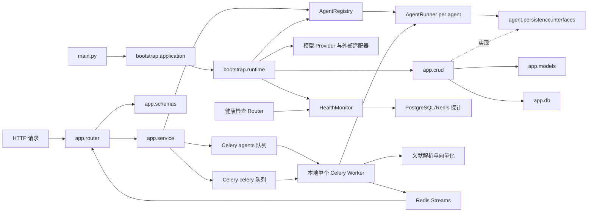

# 后端架构与扩展约定

本文说明后端模块的职责、依赖方向，以及新增能力应放置的位置。项目快速导航见[项目知识地图](项目知识地图.md)，启动方式见根目录 [README](../README.md)，接口定义见[API 接口文档](接口文档.md)，数据库定义见[数据库结构说明](数据库文档.md)。

## 请求与组装流程

`bootstrap.application` 创建 FastAPI 应用并注册 Router 和异常处理器；`bootstrap.runtime` 启动时创建各智能体图和 Runner，并将 `app.crud` 中的 PostgreSQL Store 注入运行器所依赖的持久化协议。聊天 SSE 提交先保存 queued 运行和用户消息，再派发到 Celery `agents` 队列；文献导入任务进入默认 `celery` 队列。本地 Compose 使用一个 Celery Worker 同时监听这两个队列，执行 Runner 或文献解析与向量化，并将聊天事件写入版本化 Redis Stream；HTTP SSE 连接只读取事件流。Worker 使用 `solo` 单并发模式，任务串行执行，长时间文献任务会延迟排队中的聊天任务。外发事件固定为 `event_id`、`event_type`、UTC `timestamp` 和 `data` 四个字段；会话和运行标识通过请求、响应头及服务端上下文管理。连接断开不影响 Worker；显式停止通过 Redis 共享取消标志到达执行进程。Router 按 `AgentType` 字符串枚举从显式注册表取得对应应用 Service。文献解析和向量化状态以 PostgreSQL 为准。

后端健康巡检器在 `bootstrap.runtime` lifespan 中创建、启动和停止，定时并发探测 PostgreSQL 与 Redis Broker。`app.router.health` 只读取最近一次状态快照；具体连接和探测由 `infra.health_probes` 提供，避免将轮询和外部客户端放进 HTTP 路由。

## 模块职责

| 位置 | 职责 | 不负责 |
|---|---|---|
| `bootstrap/` | 创建 FastAPI 应用；组装模型 Provider、智能体图、Runner、Service、存储和运行资源生命周期 | 承载 HTTP 路由实现、业务用例和 SQL 查询 |
| `app/router/` | 接收 HTTP 参数、解析身份、调用 Service、转换 JSON/SSE 响应 | Agent 流程和 SQL |
| `app/service/` | 编排应用用例和健康巡检状态；不依赖 FastAPI 请求对象 | 直接执行 SQL |
| `app/crud/` | 按会话、消息、运行和任务结果执行 SQLAlchemy ORM 查询及持久化 | HTTP 参数解析和智能体图流程 |
| `app/models/` | 定义与 Pydantic DTO 分离的 SQLAlchemy 持久化模型 | HTTP 请求和响应校验 |
| `app/db/` | 创建 SQLAlchemy 引擎和 Session 工厂，管理数据库资源生命周期 | 业务查询和 HTTP 流程 |
| `app/schemas/` | 定义 HTTP 请求和响应 DTO | 保存图状态或数据库实体 |
| `agent/` | 提供共享 Runner、稳定事件、追问协议、持久化协议；保留现有默认智能体图 | 导入 `app`、FastAPI 或 HTTP DTO |
| `agents/` | 按业务目录保存独立智能体图、状态、节点、提示词、工具和 Provider 适配 | 复制公共 Runner、SSE 或持久化代码 |
| `agents/registry.py` | 按 `AgentType` 显式登记智能体定义和应用 Service | 自动发现任意 Python 包 |
| `agent/persistence/interfaces.py` | 声明 Runner 所依赖的存储协议；`memory.py` 提供内存测试适配器 | PostgreSQL SQL 和 FastAPI 路由 |
| `infra/` | 集中管理配置、外部 Provider 和 PostgreSQL/Redis 健康探针 | 承载 HTTP 路由或业务图流程 |
| `infra/agent_event_store.py` | 使用 Redis Streams 分配 run 游标、保存/回放四字段协议事件及共享取消标志 | 取代进程内 SSE 缓冲，不承担消息历史 |
| `infra/agent_task_queue.py`、`app/service/agent_tasks.py` | 将稳定运行 ID 派发到专属 Celery 队列，并在 Worker 中重建 Runtime | HTTP/SSE 连接生命周期 |
| `main.py` | 暴露 Uvicorn 所需的 `app` 实例 | 组装运行依赖 |

## 依赖与数据边界

- Router 调用 Service；Service 按 `AgentType` 查找应用 Service 并调用 Runner。
- `agent/`、`agents/` 和基础设施模块不导入 FastAPI Router 或 HTTP DTO。
- `app.crud` 使用 SQLAlchemy ORM 实现 `agent.persistence.interfaces` 中的存储协议；Runner 只依赖协议，不直接依赖数据库模型或 PostgreSQL 实现。
- `app/models/` 保存数据库持久化模型；`app/schemas/` 保存 HTTP 请求与响应模型；`agent/schemas/` 保存运行记录、图问题、事件和任务结果领域记录。
- `app/db/` 创建 SQLAlchemy 引擎和会话工厂；CRUD 操作按调用创建并关闭短生命周期 Session。会话级 advisory lock 使用独立的 psycopg 连接池，使运行期间锁连接与 ORM 查询连接分离。`psycopg` 提供 PostgreSQL 驱动，LangGraph Checkpointer 继续使用其独立适配器。
- 应用启动时由 ORM 元数据创建缺失的应用表；`create_all` 不会修改已有表，结构变更仍须通过 `backend/migrations/` 管理。图片字节由 `infra/aliyun_oss.py` 保存到私有 OSS。
- `agent/errors.py` 定义运行时业务异常；`app/exceptions/handlers.py` 将其转换为 HTTP 响应。
- `infra/settings.py` 是配置入口。Provider 和智能体节点通过构造注入使用配置；节点和工具不直接读取环境变量。
- `app/dependencies/` 保存 HTTP 依赖，例如可信主体解析；`bootstrap/` 是应用组合根，负责运行资源的创建与释放。

数据库持久化范围见[数据库结构说明](数据库文档.md)。

## 扩展默认智能体

`backend/agent/` 中的 `state.py`、`nodes/`、`tools/`、`prompts/` 和 `graph.py` 属于当前默认智能体。若要修改默认对话能力，可以继续在这些文件中扩展。`agent/tools/registry.py` 中的 `AGENT_TOOLS` 只登记默认图的工具。

## 新增独立智能体

1. 在 `backend/agents/<business_name>/` 新建业务状态、图、节点、系统提示词和专属工具。
2. 在 `backend/agent/enums.py` 增加 `AgentType` 枚举值，并在 `backend/agents/registry.py` 与 `AgentDefinition` 中登记名称、描述和能力。
3. 在 `bootstrap/runtime.py` 组装 Provider、图、Runner 和应用 Service；共享数据库、Checkpointer、问题协议和 SSE。
4. 将业务结果元数据保存到统一 `task_results` 表；大文件放入对象存储并在 JSON 元数据中保留对象键。
5. 为新图、追问恢复、Provider 错误、结果持久化和资源授权增加离线测试。

基础对话助手 `basic_conversation_agent` 使用 `agents/base_agent/` 提供的通用图，并由 `bootstrap/runtime.py` 注入模型与共享 PostgreSQL Checkpointer。聊天 Runner 按可信主体、智能体枚举值和会话 ID 设置 `thread_id`，因此每轮只需输入新消息，图会从 Checkpoint 恢复本会话历史；该历史与应用消息表分别用于图状态恢复和聊天记录展示。

当前图片智能体位于 `backend/agents/image_agent/`，稳定标识为 `image_agent`。图片业务实现不放入通用智能体的业务图目录。

### listing生成智能体

listing生成智能体位于 `backend/agents/listing_agent/`，稳定标识为 `listing_agent`。其图复用已配置的 DeepSeek ChatModel，以多模态消息识别图片中的外观、包装文字和可见特征，再规划必要问题；问题全部非空回答后才生成恰好 3 个版本，并写入共享 `task_results.result`。图片字节经 AttachmentStore 授权读取，不进入 PostgreSQL JSON 或 Checkpoint。

完整结果通过 TaskResultApplicationService 按主体校验后返回；前端结果卡片通过结果 ID 读取 JSON 并展示版本。识图、信息规划和文案生成共用 `DEEPSEEK_MODEL`、`DEEPSEEK_API_KEY`、`DEEPSEEK_BASE_URL` 与 `DEEPSEEK_TIMEOUT_SECONDS` 配置。TokenHub 继续用于图片智能体的生图能力。

## 增加普通业务数据

普通业务数据按职责分别放入 `app/router/`、`app/service/`、`app/crud/`、`app/models/` 和 `app/schemas/`：Router 处理 HTTP 边界，Service 编排用例，CRUD 负责持久化，Models 定义数据库实体，Schemas 定义接口 DTO。只有确有独立的数据访问或业务边界时才增加相应模块，不为每张表机械地增加一层抽象。

MCP 接入属于工具能力时放在智能体 Tools 或独立集成模块；RAG 的文档处理、切分、Embedding、检索和生成应作为独立 AI 模块，不放进通用 Router、CRUD 或 Agent Service。

### 科研文献检索智能体

科研文献检索位于 backend/agents/research_agent/，稳定标识为 research_agent。图节点调用现有 ChatModel 解析检索词和约束，再由异步 HTTPX OpenAlex Client 查询 Works API。论文字段只从 OpenAlex 响应映射，摘要由其倒排索引重建；作者、DOI、年份、语言和引用量均由标准化器校验、过滤和去重。

单次检索至多执行配置允许的 3 轮等义查询。年份和语言等明确条件在所有轮次保持不变。完整论文数组只写入共享 `task_results.result`；LangGraph Checkpoint、SSE 工具消息和助手回复只保留检索计划、任务状态和数量摘要。结果详情 Service 沿用会话所有者校验，前端按会话智能体标识展示科研结果卡片。专用 REST Router 调用相同的 Agent Service，不复制检索执行或持久化逻辑。

### 劳动法律问答智能体

劳动法律问答位于 `backend/agents/labor_law_agent/`，稳定标识为 `labor_law_agent`。用户通过聊天页“开启新对话”进入现有智能体选择器；该智能体使用与项目其他智能体相同的聊天 API 和运行时。法律原件放在该目录的 `data/legal_corpus/source/`，由 `backend/scripts/ingest_labor_law_corpus.py` 命令行入口组合领域导入服务与 PostgreSQL 适配器，解析后按法律版本、条文写入 PostgreSQL + pgvector；对话查询组合条号/关键词检索与向量检索，再将检索证据交给模型生成回答。服务端根据已检索法条 ID 输出名称、条号、原文和官方来源，依据不足时返回固定说明。Embedding 使用 TokenHub Kinfra 模型，并复用项目已有 `TENCENT_TOKENHUB_API_KEY`；限定访问范围的 Key 需获准调用该模型。

### 文献解读助手

文献解读助手位于 `backend/agents/literature_reader_agent/`，稳定标识为 `literature_reader_agent`。新文献只支持 PDF 上传。专用 Service 验证可信主体和所选文献后，通过 `graph_context` 将文献 ID 注入四节点图；`retrieve_evidence` 按所有者、ready 状态和选择集合执行关键词与 pgvector 混合检索，生成节点仅接收证据，核验节点检查原文摘录并按数据库位置渲染 PDF 引文。既有网页来源文献保留原有来源标记，但不再提供网页导入。

PDF 原件由 `infra/literature_document_storage.py` 保存到私有 OSS；`literature_documents`、`literature_chunks` 和 `literature_conversation_documents` 保存元数据、原文分块/向量和会话当前选择。HTTP DTO 位于 `app/schemas/literature.py`，图运行时结构位于 Agent schemas。`infra/celery_app.py` 使用 Redis Broker，`app/service/literature_tasks.py` 从 OSS 读取 PDF 并执行解析、切分和 Embedding。数据库升级由 `backend/migrations/005_literature_reader.sql` 管理。
