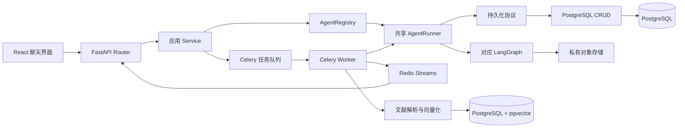

# NexusAI 项目知识地图

本文是项目导航页，帮助 AI 和新成员快速定位真实代码、权威契约和验证入口。它只保留全局摘要；详细规则以对应代码、测试和专题文档为准。

## 项目是什么

NexusAI 是一个多智能体对话应用。用户通过邮箱账号登录后，在同一聊天界面选择智能体，通过 HTTP 和 SSE 与后端交互。未登录首页展示智能体目录和账号入口。项目还提供文献导入与问答，以及一个独立的小游戏功能。用户可见能力和启动说明见[项目 README](../README.md)。

| 层次 | 当前技术 | 主要入口 |
|---|---|---|
| 前端 | React 19、TypeScript 6、Vite 8 | `frontend/src/main.tsx`、`frontend/src/App.tsx` |
| 后端 | Python 3.12.13、FastAPI、Pydantic 2、SQLAlchemy 2、LangGraph 1 | `backend/main.py`、`backend/bootstrap/application.py` |
| 持久化与任务 | PostgreSQL、pgvector、Redis、Celery、LangGraph PostgreSQL Checkpointer | `backend/app/db/`、`backend/infra/` |
| 文件与模型服务 | 私有阿里云 OSS、DeepSeek、Tencent TokenHub、OpenAlex | `backend/infra/` 及各 Agent 的 `providers/` |

依赖版本和本地启动步骤以 [README](../README.md)、`backend/requirements.txt`、`backend/pyproject.toml` 和 `frontend/package.json` 为准。

## 核心请求与运行链路

- 应用入口创建 FastAPI 并注册路由：`backend/main.py`、`backend/bootstrap/application.py`。
- 运行时组装 Provider、Checkpointer、各智能体图和 Runner：`backend/bootstrap/runtime.py`。
- Router 解析 HTTP 请求和可信主体，Service 编排用例，注册表按稳定 Agent 标识提供对应服务。
- Agent Runner 依赖 `backend/agent/persistence/interfaces.py` 中的协议；PostgreSQL CRUD 在 `backend/app/crud/` 提供持久化实现。
- 聊天运行通过 Celery 后台执行；Redis Streams 保存有界事件流，供 SSE 连接监听或恢复。连接与运行生命周期的详细约定见[架构说明](架构说明.md)和[接口文档](接口文档.md)。
- 上传文件保存在私有 OSS。文献解析和检索使用 PostgreSQL 与 pgvector；完整表结构及升级规则见[数据库文档](数据库文档.md)。

## 智能体目录

稳定 Agent 标识定义在 `backend/agent/enums.py`；名称、能力和应用服务由 `backend/agents/registry.py` 维护；各图和运行依赖由 `backend/bootstrap/runtime.py` 组装。新增或移除智能体时应核对这三处及 API 文档和相应测试。

| Agent 标识 | 主要职责 | 实现入口 | 深入阅读 |
|---|---|---|---|
| `common_agent` | 日常交流、常见问题和项目智能体介绍 | 共享默认图 `backend/agent/graph.py` | `backend/agent/nodes/`、`backend/agent/tools/`、`backend/agent/prompts/` |
| `basic_conversation_agent` | 基于通用智能体基座进行多轮自然对话和结构化提问 | `backend/agents/base_agent/` | `backend/agents/base_agent/README.md`、`prompts/`、`tools/` |
| `image_agent` | 商品图片生成与生图参数处理 | `backend/agents/image_agent/graph.py` | `nodes/`、`tools/`、`providers/`、`parameter_policy.py` |
| `listing_agent` | 商品图像识别、补充必要信息并生成三个 Listing 版本 | `backend/agents/listing_agent/graph.py` | `nodes/`、`tools/`、`prompts.py` |
| `research_agent` | 通过 OpenAlex 检索、标准化并保存论文结果 | `backend/agents/research_agent/graph.py` | `nodes/`、`providers/openalex_client.py`、`services/` |
| `labor_law_agent` | 检索劳动法规证据并生成带来源的回答 | `backend/agents/labor_law_agent/graph.py` | `retrieval.py`、`repository.py`、`data/legal_corpus/README.md` |
| `literature_reader_agent` | 对用户导入并选择的文献做证据检索、问答和引用核验 | `backend/agents/literature_reader_agent/graph.py` | `retrieval.py`、`document_parser.py`、`chunker.py`、[接口文档](接口文档.md)、[数据库文档](数据库文档.md) |
| `job_agent` | 简历工作台中的求职对话、结构化追问与岗位方向推荐 | `backend/agents/job_agent/graph.py` | `backend/agents/job_agent/README.md`、`prompts/`、`tools/`、`recommendation/` |

后端测试位于 `backend/tests/`，通常按 Agent 名称搜索。当前有 `test_base_agent.py`、`test_image_agent.py`、`test_listing_agent.py`、`test_research_agent.py`、`test_literature_reader.py` 等相关测试；共享运行链路还应查看 `test_runtime.py`、`test_api.py`、`test_agent_tasks.py` 和 `test_agent_event_store.py`。劳动法律 Agent 当前没有同名的专属测试文件，修改该模块时需检查运行时、基础设施和数据库测试覆盖是否适用。

## 按任务定位代码和资料

| 任务 | 首批阅读资料 | 典型代码入口 |
|---|---|---|
| 项目全貌或模块边界 | 本文、[架构说明](架构说明.md) | `backend/bootstrap/`、`backend/agents/registry.py` |
| Agent 注册、运行、追问、SSE 或恢复 | [架构说明](架构说明.md)、[接口文档](接口文档.md)、对应 Agent 测试 | `backend/agent/`、`backend/agents/registry.py`、`backend/bootstrap/runtime.py` |
| HTTP API、请求响应或错误码 | [接口文档](接口文档.md)、API 测试 | `backend/app/router/`、`backend/app/schemas/`、`backend/app/service/` |
| 数据表、归属、索引或迁移 | [数据库文档](数据库文档.md)、持久化测试 | `backend/app/models/`、`backend/app/crud/`、`backend/migrations/` |
| 聊天 UI、消息和 SSE 消费 | [接口文档](接口文档.md)、聊天模型与测试 | `frontend/src/features/chat/`、`frontend/src/shared/api/sseParser.mjs` |
| 模型提示词或 Agent 业务约束 | 对应 Agent 的提示词、图、Schema、测试；对外行为再查[接口文档](接口文档.md) | `backend/agents/<agent_name>/` 或 `backend/agent/prompts/` |
| 配置、外部服务或部署 | [README](../README.md)、`backend/.env.example`、相关基础设施代码 | `backend/infra/`、`backend/compose.yaml` |

常规检索步骤：先检查 `git status --short` 与相关差异；使用 `rg --files <目录>` 找文件，以 `rg <符号或字段>` 找定义和调用方；沿实际调用链阅读相关实现及测试；只在影响跨模块契约时扩展到其他文档。不要默认读取整个 `docs/change-records/`，只在需要追溯相关历史时读取对应记录。

## 跨模块约束的权威来源

以下是导航摘要，维护详细内容时更新其权威来源，避免在本页复制整份规则：

- 开发分层、安全边界、可信主体、ID 传输和交付约定：根目录 [AGENTS.md](../AGENTS.md)。
- 对外路由、SSE 事件、追问载荷和错误语义：[接口文档](接口文档.md)及 `backend/app/schemas/`、`backend/agent/streaming/`。
- ORM 表、外键、索引和升级策略：[数据库文档](数据库文档.md)、`backend/app/models/`、`backend/migrations/`。
- 通用对话基座的节点和提问工具：`backend/agents/base_agent/README.md`、`backend/agents/base_agent/prompts/`、`backend/agents/base_agent/tools/`。
- 某个业务 Agent 的行为约束：对应目录中的 `prompts`、Schema、工具和节点；将提示词规则视为模型行为指导，服务端校验和测试定义可验证边界。
- 变更历史：`docs/change-records/`；实施方案和测试报告分别位于 `docs/implementation-plans/`、`docs/test-reports/`。它们描述特定任务，不替代当前架构和契约文档。

## 文档更新触发条件

| 代码变化 | 应检查的长期文档 |
|---|---|
| 模块边界、运行时组装、任务队列或事件恢复流程变化 | `docs/架构说明.md`；重大持久决策按需新增 ADR |
| API、SSE、追问协议、错误码、认证流程或用户可见 Agent 行为变化 | `docs/接口文档.md` |
| ORM、迁移、索引、认证会话、ID 或数据保留方式变化 | `docs/数据库文档.md` |
| Agent 注册、标识、职责或目录变化 | 本文 Agent 目录、`backend/agent/enums.py`、`backend/agents/registry.py`、`docs/接口文档.md` |
| 启动命令、开发依赖或配置入口变化 | `README.md`、`backend/.env.example` 及对应配置说明 |
| 重要功能、缺陷修复或工程化改造 | 按根目录 `AGENTS.md` 更新任务变更记录和 `CHANGELOG.md` |

纯内部实现整理若不改变业务行为、模块边界、持久化或对外契约，可只更新测试，不必新增长期说明。

## 验证命令

- 后端：从 `backend/` 运行 `python -m pytest -q`。
- 前端单元测试：从 `frontend/` 运行 `npm test`。
- 前端类型检查和构建：从 `frontend/` 运行 `npm run build`。
- 提交前检查差异：在仓库根目录运行 `git diff --check` 并审阅 `git diff`。

按任务选择相关命令；报告中只列出实际运行的检查及结果。
